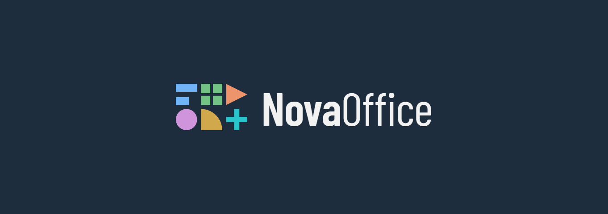

<p align="center">
  
</p>

<p align="center">
  <strong>Suíte office modular e open source.</strong><br>
  Núcleo em Rust, documentos em CRDT prontos para coedição e app desktop em Tauri.
</p>

<p align="center">
  <a href="https://github.com/Acnaell/novaoffice/actions/workflows/ci.yml"></a>
  <a href="https://github.com/Acnaell/novaoffice/releases/latest"></a>
  <a href="LICENSE"></a>
</p>

## A suíte

Cada aplicativo tem sua forma e sua cor no símbolo da NovaOffice.

<table>
  <tr>
    <td><picture><source media="(prefers-color-scheme: dark)" srcset="assets/brand/products/card-text-dark.png"></picture><br><sub><b>Em desenvolvimento</b>: editor de texto no app desktop (MVP)</sub></td>
    <td><picture><source media="(prefers-color-scheme: dark)" srcset="assets/brand/products/card-sheets-dark.png"></picture><br><sub>Planejado: planilhas</sub></td>
  </tr>
  <tr>
    <td><picture><source media="(prefers-color-scheme: dark)" srcset="assets/brand/products/card-slides-dark.png"></picture><br><sub>Planejado: apresentações</sub></td>
    <td><picture><source media="(prefers-color-scheme: dark)" srcset="assets/brand/products/card-draw-dark.png"></picture><br><sub>Planejado: desenho vetorial</sub></td>
  </tr>
  <tr>
    <td><picture><source media="(prefers-color-scheme: dark)" srcset="assets/brand/products/card-base-dark.png"></picture><br><sub>Planejado: banco de dados</sub></td>
    <td><picture><source media="(prefers-color-scheme: dark)" srcset="assets/brand/products/card-math-dark.png"></picture><br><sub>Planejado: fórmulas matemáticas</sub></td>
  </tr>
</table>

## Baixar

Os instaladores ficam na página de [Releases](https://github.com/Acnaell/novaoffice/releases/latest).

| Sistema | App desktop | CLI `nova` |
| --- | --- | --- |
| Windows 10/11 | `NovaOffice_<versão>_x64-setup.exe` ou `.msi` | `nova-x86_64-pc-windows-msvc.zip` |
| macOS Apple Silicon | `NovaOffice_<versão>_aarch64.dmg` | `nova-aarch64-apple-darwin.tar.gz` |
| macOS Intel | `NovaOffice_<versão>_x64.dmg` | `nova-x86_64-apple-darwin.tar.gz` |
| Linux x86_64 | `.AppImage`, `.deb` ou `.rpm` | `nova-x86_64-unknown-linux-gnu.tar.gz` |
| Linux ARM64 | | `nova-aarch64-unknown-linux-gnu.tar.gz` |

Os instaladores ainda não têm assinatura digital: no Windows o SmartScreen pode pedir
"Mais informações → Executar assim mesmo"; no macOS, abra com o botão direito → **Abrir** na primeira vez.

O CLI também instala com um comando, que escolhe o pacote certo e confere o SHA-256:

```powershell
# Windows (PowerShell)
irm https://raw.githubusercontent.com/Acnaell/novaoffice/main/scripts/install.ps1 | iex
```

```sh
# Linux e macOS
curl -fsSL https://raw.githubusercontent.com/Acnaell/novaoffice/main/scripts/install.sh | sh
```

## Estado atual (MVP, incremento 3)

| Módulo | Papel |
| --- | --- |
| `apps/desktop` | App desktop: Tauri 2 (`src-tauri`) com o núcleo em processo e editor React/TypeScript |
| `crates/nova-crdt` | Encapsula o Yrs: parágrafos como mapas (estilo + texto formatado), offsets UTF-16, desfazer local, sincronização por state vector |
| `crates/nova-domain-text` | Agregado `TextDocument`: comandos, eventos de domínio, marcas de caractere, estilos de parágrafo, validação |
| `crates/nova-app` | `Session` (despacho de comandos em Rust ou JSON, assinantes de eventos), formato `.nova` (versão 2) e exportação Markdown |
| `apps/cli` | Binário `nova` para criar, importar, editar, exportar (texto ou Markdown) e fundir documentos |

A arquitetura completa está no documento "LibreOffice: Análise Arquitetural e Proposta NovaOffice"
e as decisões ficam registradas em [docs/adr](docs/adr).

## Preparar o ambiente de desenvolvimento (Windows)

1. Visual Studio Build Tools (2022 ou 2026) com a carga "Desenvolvimento para desktop com C++":
   `winget install Microsoft.VisualStudio.2022.BuildTools --override "--wait --add Microsoft.VisualStudio.Workload.VCTools --includeRecommended"`
2. Rust: `winget install Rustlang.Rustup` e depois, em um terminal novo, `rustup default stable`
3. Git: `winget install Git.Git`

## Compilar e testar

```powershell
cargo test --workspace
cargo clippy --workspace --all-targets -- -D warnings
cargo fmt --all -- --check
cargo run -p nova-cli -- --help
```

## App desktop

Requer Node.js 22 ou mais recente e, no Windows, o WebView2 (já vem no Windows 10 e 11 atualizados).
No Linux, instale também as dependências do Tauri:
`sudo apt install libwebkit2gtk-4.1-dev libxdo-dev libssl-dev libayatana-appindicator3-dev librsvg2-dev`.

```powershell
cd apps/desktop
npm install
npm run tauri dev      # abre o app com recarga automática do front-end
npm test               # testes da lógica do editor (Vitest)
npm run tauri build    # instalador em target/release/bundle
npm run build && npm run e2e   # fluxos do Word na interface real (ver abaixo)
```   # fluxos do Word na interface real (ver abaixo)
```

### Página Inicial

A faixa de opções segue a organização do Microsoft Word, com os mesmos grupos e botões:

| Grupo | Comandos |
| --- | --- |
| Área de Transferência | Colar (manter formatação original ou somente texto), Recortar, Copiar, Pincel de Formatação (clique duplo deixa fixo) |
| Fonte | Fonte (fontes do tema e instaladas), tamanho, aumentar/diminuir tamanho, Maiúsculas e Minúsculas, Limpar Toda a Formatação, N I S T, subscrito, sobrescrito, realce, cor da fonte |
| Parágrafo | Marcadores, numeração (1. → a. → i. por nível), diminuir/aumentar recuo, Mostrar Tudo ¶, alinhamentos, espaçamento entre linhas e antes/depois do parágrafo |
| Estilos | Texto normal, Título 1 a 6, Citação, Código |
| Editando | Localizar e Substituir no painel de Navegação, Selecionar Tudo |

Como no Word: com o cursor parado dentro de uma palavra, negrito, cor ou fonte valem para a palavra
inteira; "- " ou "1. " no começo do parágrafo viram lista; Enter num item vazio sai da lista; Tab e
Shift+Tab mudam o nível do item; copiar leva a formatação para o Word, navegador e e-mail, e colar de
lá traz negrito, cores, tamanhos, títulos, listas e alinhamento.

### Atalhos

Os atalhos acompanham o idioma da interface, como no Word: em português valem os do Word em
português; em inglês, os do Word em inglês.

| Ação | Português | Inglês |
| --- | --- | --- |
| Negrito, itálico, sublinhado | Ctrl+N, Ctrl+I, Ctrl+S | Ctrl+B, Ctrl+I, Ctrl+U |
| Novo, abrir, salvar, salvar como | Ctrl+O, Ctrl+A, Ctrl+B, F12 | Ctrl+N, Ctrl+O, Ctrl+S, F12 |
| Selecionar tudo | Ctrl+T | Ctrl+A |
| Localizar, substituir | Ctrl+L, Ctrl+U | Ctrl+F, Ctrl+H |
| Alinhar à esquerda, centralizar, à direita, justificar | Ctrl+Q, Ctrl+E, Ctrl+G, Ctrl+J | Ctrl+L, Ctrl+E, Ctrl+R, Ctrl+J |
| Desfazer, refazer | Ctrl+Z, Ctrl+R ou Ctrl+Y | Ctrl+Z, Ctrl+Y |

Iguais nos dois: Ctrl+= e Ctrl+Shift+= (subscrito e sobrescrito), Ctrl+Espaço (limpar formatação),
Ctrl+Shift+> e Ctrl+Shift+< (tamanho da fonte), Shift+F3 (maiúsculas e minúsculas), Ctrl+Shift+C e
Ctrl+Shift+V (copiar e colar formatação), Ctrl+M e Ctrl+Shift+M (recuo), Ctrl+1, Ctrl+5 e Ctrl+2
(entrelinhas 1,0, 1,5 e 2,0), Ctrl+Shift+L (marcadores), Ctrl+Shift+8 (Mostrar Tudo), Ctrl+Alt+1 a 6
(títulos), Shift+Enter (quebra de linha), Ctrl+↑/↓ (parágrafo anterior/seguinte).

### Como funciona

O editor usa um `contenteditable` só para ter cursor, seleção e IME nativos. Cada `beforeinput` é
cancelado e vira um comando do núcleo (`src/model.ts`, `src/formatting.ts`); a resposta traz só os
parágrafos que mudaram, e só eles são redesenhados. O DOM nunca é a fonte da verdade.

### Fluxos do Word (e2e)

`apps/desktop/e2e` tem uma bateria com cerca de 90 fluxos do Word (digitar com acentos, selecionar,
formatar, listas, colar do Word, localizar e substituir, salvar e reabrir…). Cada fluxo dirige a
interface real no Chromium, com o núcleo Rust real por trás (`e2e/bridge`, no lugar do IPC do Tauri),
e é classificado como funciona, parcial, com falha ou ainda não existe. O resultado fica em
`e2e/RESULTADOS.md` e o CI falha se algum fluxo que já funcionava quebrar.

Limitações conhecidas: fechar a janela não pergunta sobre alterações não salvas; arrastar e soltar
texto está desativado; ainda não há paginação, tabelas, imagens nem revisão ortográfica própria.

## CLI

O binário `nova` cria, importa, edita, exporta e funde documentos `.nova` pela linha de comando.
Exemplos e a lista completa de comandos estão em [docs/CLI.md](docs/CLI.md).

## Próximos incrementos do MVP

- [x] Formatação de caracteres (negrito, itálico, sublinhado, tachado, fonte, tamanho, cor)
- [x] Estilos de parágrafo (títulos 1 a 6, citação, código)
- [x] Desfazer e refazer por usuário (`UndoManager` do Yrs)
- [ ] Listas, tabelas e imagens como blocos tipados
- [ ] Âncoras estáveis (`StickyIndex`) no lugar de índices de bloco
- [ ] Divisão de bloco que preserve digitação concorrente no fim do parágrafo (hoje converge, mas o texto digitado em paralelo fica no primeiro bloco)
- [ ] Eventos para mudanças remotas
- [ ] `nova-layout`: shaping (HarfBuzz) e paginação
- [x] `apps/desktop`: Tauri + React com editor de texto ligado ao núcleo
- [ ] Perguntar sobre alterações não salvas ao fechar a janela; colar com formatação
- [ ] Planilha: `nova-domain-sheet` e `nova-calc`
- [ ] Plugins de formato: ODT e DOCX primeiro
- [x] CI no GitHub Actions (fmt, clippy, testes em Windows, macOS e Linux)
- [x] Distribuição pelo GitHub Releases (veja [docs/RELEASING.md](docs/RELEASING.md))

## Identidade visual

Logo, ícones, cores e os cards de cada aplicativo ficam em [assets/brand](assets/brand);
as regras de uso estão em [docs/BRAND.md](docs/BRAND.md).

## Licença

Distribuído sob a [licença MIT](LICENSE).
